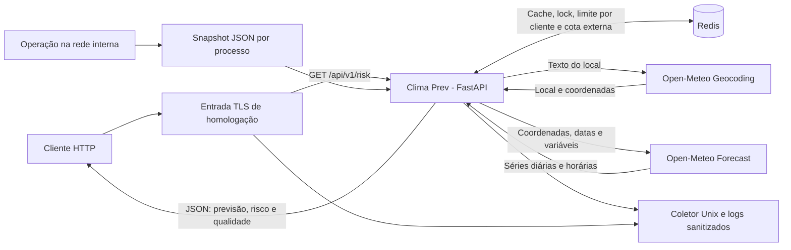
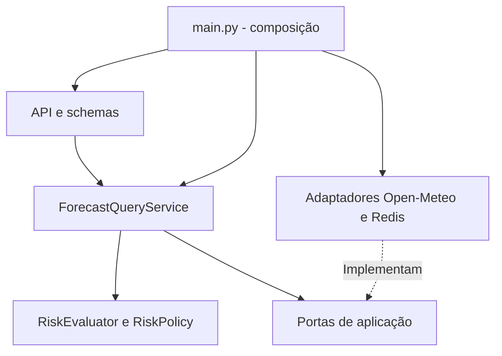
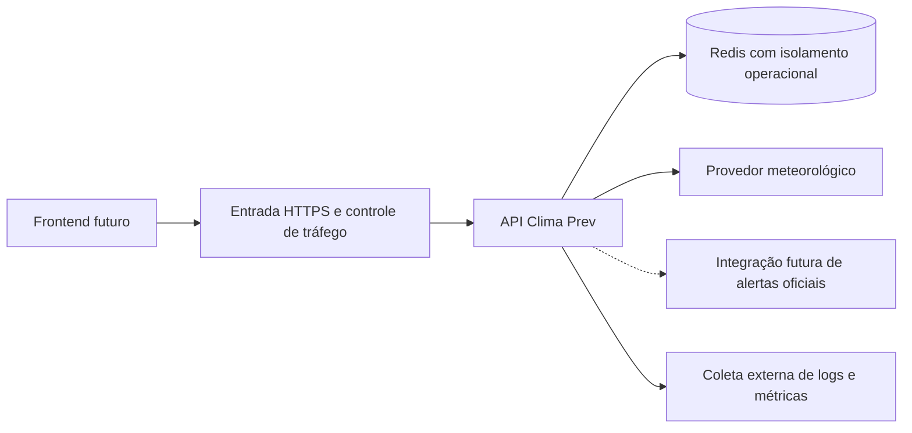

# Arquitetura do Clima Prev

**Estado:** implementação observada em 2026-09-13, com evolução indicada
separadamente. [Índice](../PROJECT.md).

## Visão de contexto

Não há frontend, banco relacional, fila de mensagens ou serviço externo de
alertas oficiais configurado no código atual.

## Componentes e responsabilidades

| Camada               | Evidência                                                                                                                                                                                              | Responsabilidade e limite                                         |
| -------------------- | ------------------------------------------------------------------------------------------------------------------------------------------------------------------------------------------------------ | ----------------------------------------------------------------- |
| Entrada HTTP         | [Rotas](../src/climaprev/api/routes/risk.py), [schema](../src/climaprev/api/schemas/risk.py)                                                                                                           | Validar query e serializar resposta; não calcular risco.          |
| Proteção de entrada  | [Dependências](../src/climaprev/api/deps.py)                                                                                                                                                           | Resolver identidade de rede e aplicar rate limit.                 |
| Aplicação            | [Serviço de consulta](../src/climaprev/application/services/forecast_query.py)                                                                                                                         | Resolver local, cache, lock, previsão, avaliação e alertas.       |
| Contratos internos   | [Portas](../src/climaprev/application/ports.py), [query](../src/climaprev/application/query.py)                                                                                                        | Separar operações de suas implementações.                         |
| Domínio              | [Modelos](../src/climaprev/domain/models.py), [avaliador](../src/climaprev/domain/risk_evaluator.py), [política](../src/climaprev/domain/risk_policy.py)                                               | Regras determinísticas sem acesso à rede.                         |
| Meteorologia         | [Adaptador](../src/climaprev/infrastructure/providers/open_meteo.py), [HTTP](../src/climaprev/infrastructure/http/client.py)                                                                           | Consultar e normalizar respostas externas.                        |
| Estado compartilhado | [Cache](../src/climaprev/infrastructure/cache/redis_cache.py), [lock](../src/climaprev/infrastructure/cache/redis_lock.py), [limite](../src/climaprev/infrastructure/rate_limit/redis_rate_limiter.py) | Redis para estado temporário; não fornece histórico de consultas. |
| Composição           | [main.py](../src/climaprev/main.py), [configuração](../src/climaprev/config.py)                                                                                                                        | Criar clientes e injetar dependências no ciclo de vida do app.    |

Os erros que atravessam as integrações ficam no
[contrato de aplicação](../src/climaprev/application/errors.py). O serviço
depende das portas e desses erros, enquanto os adaptadores traduzem falhas
externas. O cálculo de [completude](../src/climaprev/domain/data_quality.py)
fica no domínio, separado da política de risco.

## Implantação existente

- Python `>=3.12,<3.13`, FastAPI, Uvicorn, HTTPX e Redis, declarados no
  [pyproject.toml](../pyproject.toml), com versões/hashes transitivos no
  [lock de produção](../requirements.lock). O [Dockerfile](../Dockerfile)
  separa `dev` e `runtime`; a imagem final usa UID 10001 e pacote instalado
  em wheel, sem ferramentas de teste ou arquivos locais de ambiente.
- O [Compose](../docker-compose.yml) publica a API em
  `127.0.0.1:8000`; Redis não publica porta para o host.
- A rede `local` é uma rede Compose comum. Seu nome não bloqueia acesso à
  internet; a aplicação padrão consulta Open-Meteo externo.
- O [runtime](../src/climaprev/runtime.py) inicia Uvicorn sem interpretação
  automática de proxy e sem access log bruto. A API interpreta
  `X-Forwarded-For` somente para peers explicitamente confiáveis.
- O processo mantém clientes HTTP/Redis no lifespan e os fecha na saída.
- Réplicas podem compartilhar Redis; métricas em memória permanecem separadas
  por processo. O perfil `app-load` usa dois workers.
- O Compose de desenvolvimento não oferece a fronteira TLS de homologação.
  [Métricas internas](../src/climaprev/api/routes/metrics.py) expõem JSON com
  identidade, PID e início do processo. Não são agregadas automaticamente
  entre workers; acesso protegido é responsabilidade da stack de homologação.

## Homologação isolada

O [Compose de homologação](../docker-compose.homolog.yml) usa o runtime sem
privilégios, filesystem da API somente leitura e Redis com ACL. API e Redis
não publicam portas diretas. Somente o app acessa a rede interna do cache;
a saída aos provedores usa outra rede. A senha é provisionada fora do Git e
lida de arquivo montado somente nos serviços autorizados. A entrada Nginx
publica TLS apenas no loopback e bloqueia `/internal/`. Logs seguem por socket
Unix para um coletor sem rede, com retenção de até sete dias. Os comandos e
limites locais estão em [homologação](homologacao.md).

## Perfil de carga

`load` executa Locust contra `app-load`, com `provider-mock` interno e Redis
real. `app-load` usa ambiente `load` e limites elevados explícitos. As chaves
têm namespace por ambiente, mas app e carga compartilham o mesmo serviço Redis
no Compose; portanto, ainda disputam seus recursos.

O mock de carga não comprova desempenho nem disponibilidade do Open-Meteo
público. Consulte [operações](operations.md) para os comandos existentes.

## Evolução proposta

Todo o diagrama acima é um alvo de implantação, não uma descrição de serviços
já entregues. Manter a avaliação no backend, usar somente contratos públicos
no frontend e decidir autenticação antes de introduzir dados privados. Não há
necessidade demonstrada de transformar as camadas em microserviços agora.
