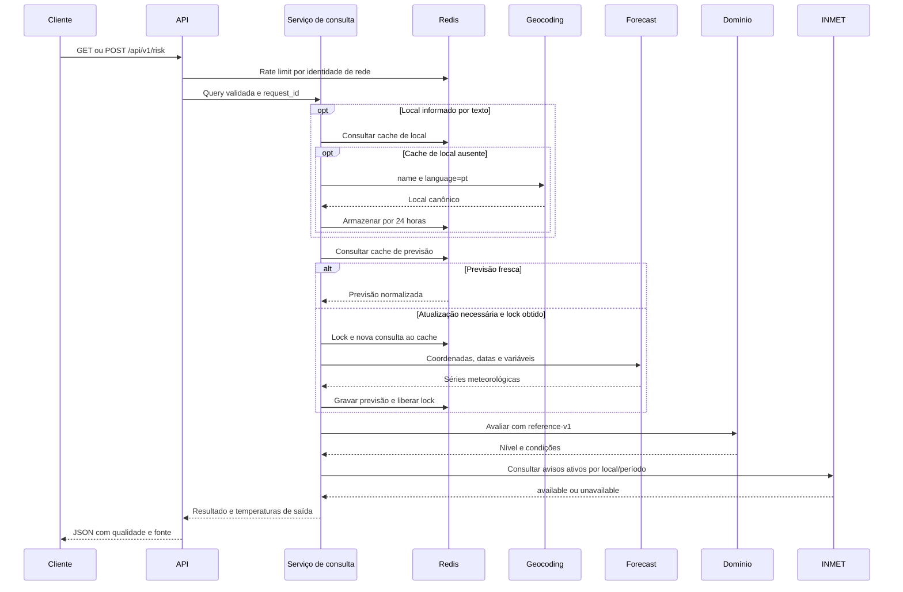
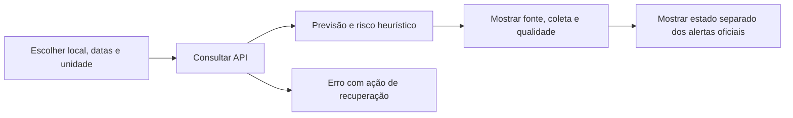

# Fluxos de consulta e operação

**Estado:** contratos implementados no backend e na interface; evidências
e progresso por tarefa no plano de evolução.
[Índice](../projeto/PROJECT.md).

## Consulta principal

1. O middleware valida ou gera `request_id`.
2. A rota executa dependências de limite por cliente e validação da query.
   Uma rejeição de limite pode ocorrer antes de a entrada ser validada.
3. Com texto, a busca de localidades consulta cache de geocodificação e, se
   necessário, Open-Meteo Geocoding. A consulta de risco usa a localidade
   selecionada; com coordenadas, constrói o local diretamente.
4. O serviço consulta previsão normalizada no Redis, usando local e datas.
5. Em cache fresco, usa o dado. Caso contrário, disputa o lock de atualização.
6. O detentor do lock verifica o cache novamente, consulta o provedor,
   normaliza os dados e grava o resultado. Renova o lock durante a consulta.
   Cada tentativa externa, incluindo geocodificação e retries, consome a cota
   compartilhada do destino antes do envio. Cache hit dispensa esse consumo.
7. O domínio calcula risco em Celsius, milímetros e km/h.
8. O serviço obtém o estado de alertas oficiais e converte temperaturas de
   saída se o cliente pediu Fahrenheit.
9. A API responde com previsão, risco, qualidade, fonte, aviso e `request_id`.
   O middleware registra metadados da requisição.

Evidências: [rota](../../src/climaprev/api/routes/risk.py),
[serviço](../../src/climaprev/application/services/forecast_query.py) e
[middleware](../../src/climaprev/api/observability.py).

## Cache e concorrência

| Estado                               | Ação atual                                    | Resultado                                   |
| ------------------------------------ | --------------------------------------------- | ------------------------------------------- |
| Previsão com idade menor que 10 min  | Usar cache.                                   | `hit`, `is_stale=false`.                    |
| Previsão entre 10 e 15 min           | Tentar atualização.                           | Resultado novo ou fallback permitido.       |
| Sem previsão ou com 15 min completos | Tentar atualização.                           | Não há fallback válido dessa entrada.       |
| Outro worker detém o lock            | Consultar lock/cache com backoff, jitter e deadline de 30 s. | Usar cache fresco que surgir ou obter lock. |
| Espera de lock encerrada             | Revalidar a expiração do stale antes de usar. | `stale` ou 503.                             |
| Atualização bem-sucedida             | Salvar previsão com TTL total de 15 min.      | `miss`, `is_stale=false`.                   |
| Falha transitória do forecast        | Revalidar a expiração do stale antes de usar. | `stale` ou 503.                             |

O lock dura 10 s e recebe renovação a cada 5 s, com token de propriedade.
A geocodificação não usa esse lock; textos distintos podem gerar consultas
externas concorrentes, limitadas pela cota global Redis por ambiente/destino.

A validade do stale é reavaliada após espera, retries e consulta opcional de
alertas, imediatamente antes da entrega. Em 900 segundos completos, a entrada
não pode ser usada. Leituras não renovam seu TTL. Corrupção do envelope de
cache produz miss e um contador fixo; indisponibilidade do Redis produz 503.
Perda de propriedade do lock cancela e aguarda a consulta externa, impede a
gravação e retorna 503, sem fallback. A liberação só remove o token próprio;
falha de limpeza não substitui um erro principal já identificado.

## Falhas e resposta ao consumidor

| HTTP / código                        | Significado                                                | Tratamento no cliente           |
| ------------------------------------ | ---------------------------------------------------------- | ----------------------------------------------- |
| 422 / `INVALID_LOCATION_INPUT`       | Local ausente, conflitante ou inválido.                    | Corrigir entrada.                               |
| 422 / `INVALID_PERIOD`               | Data inválida, ordem incorreta ou mais de sete dias.       | Corrigir período.                               |
| 422 / `INVALID_TEMPERATURE_UNIT`     | Unidade não aceita.                                        | Selecionar unidade contratada.                  |
| 404 / `LOCATION_NOT_FOUND`           | Geocodificação sem local utilizável.                       | Refinar busca.                                  |
| 429 / `RATE_LIMIT_EXCEEDED`          | Limite excedido.                                           | Respeitar `Retry-After`.                        |
| 502 / `WEATHER_DATA_INVALID`         | Estrutura meteorológica inválida.                          | Exibir indisponibilidade dos dados.             |
| 502 / `WEATHER_PROVIDER_REJECTED`    | Provedor rejeitou a consulta com 4xx diferente de 429.     | Exibir falha da consulta, sem retry automático. |
| 503 / `WEATHER_PROVIDER_UNAVAILABLE` | Falha transitória sem fallback ou espera de lock sem dado. | Permitir nova tentativa com espera.             |
| 503 / `DEPENDENCY_UNAVAILABLE`       | Redis indisponível.                                        | Exibir indisponibilidade do serviço.            |
| 500 / `INTERNAL_ERROR`               | Falha não mapeada.                                         | Mostrar erro e identificador de suporte.        |

Os [handlers](../../src/climaprev/main.py) usam mensagens sanitizadas. Um 429 do
provedor produz 503, sem retry; forecast pode usar stale ainda válido. Outros
4xx produzem 502, sem retry nem fallback. Timeout, rede e 5xx permitem até
três tentativas. Dado meteorológico inválido não aciona retry nem stale.
O 429 público permanece reservado ao limite individual do cliente.

O provedor de alertas pode falhar sem bloquear a previsão: o serviço retorna
`official_alerts.status=unavailable`. O provedor instalado consulta o INMET e
retorna `available` quando a resposta é válida. `not_configured` permanece no
contrato para o adaptador opcional de testes, mas não é o estado padrão da
composição atual.

## Jornada da interface

A interface exibe valores `null` como indisponíveis, sinaliza stale, mostra
o período/local retornados e mantém o aviso da estimativa visível. Uma nova
consulta cancela a anterior; um contador impede respostas antigas de
sobrescrever o resultado atual. Erros da consulta limpam o resultado anterior
e preservam o formulário. Em 429, a espera segue `Retry-After` válido ou 60 segundos;
a repetição depende de ação do visitante.
`not_configured` e `unavailable` não significam ausência de alertas reais.
O contrato atual oferece até cinco sugestões em
`GET /api/v1/locations/search`; a previsão só é enviada depois que o usuário
confirma a localidade.
