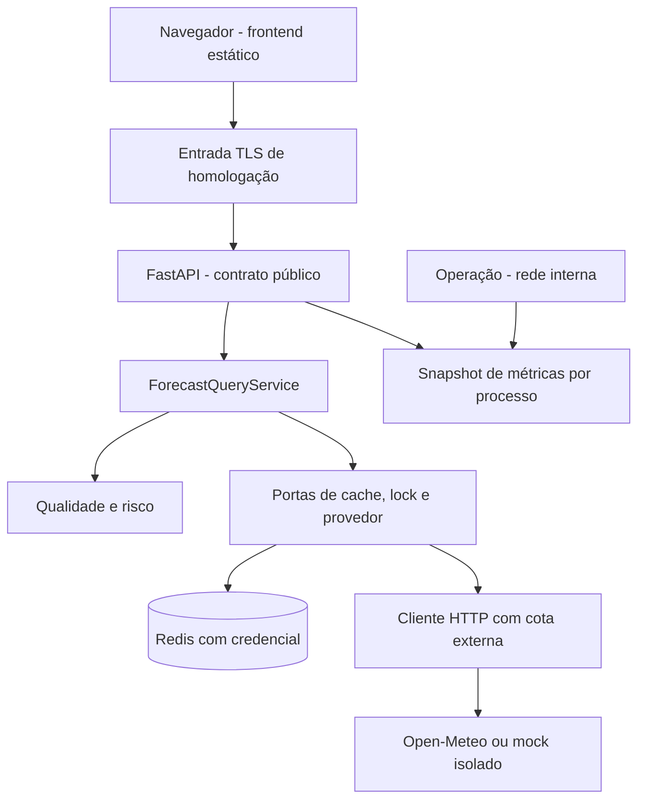

# Design — evolução do Clima Prev

<!-- estado-vigente-2026-10-20 -->
> **Sincronização documental — 20/10/2026.** Registro histórico/plano datado: o [STATE vigente](../../projeto/STATE.md) e o [RDP atualizado](../../../RELATORIO-PENDENCIAS-2026-10-20.md) definem versão, implementações, prioridades e pendências atuais. Contagens, prioridades e afirmações datadas anteriores permanecem históricas; não comprovam o estado atual nem autorização de ajuste/publicação.

**Estado:** Approved para execução local em 2026-09-13. [Contexto](context.md) · [Spec](spec.md)
· [Tarefas](tasks.md). Caminhos novos abaixo são destinos planejados, não
arquivos já implementados.

## Architecture Overview

Manter o monólito modular e as portas existentes. Corrigir contratos no
backend, preparar uma stack local de homologação e acrescentar uma interface
de consulta na mesma origem. As escolhas deste desenho são premissas técnicas
revisáveis, sem aprovação fictícia de funcionalidades futuras.

| Alternativa                                   | Benefício                                             | Custo / decisão proposta                                                   |
| --------------------------------------------- | ----------------------------------------------------- | -------------------------------------------------------------------------- |
| API atual + frontend estático na mesma origem | Reaproveita runtime, contrato e implantação.          | Escolhida para o primeiro formulário e resultado.                          |
| API atual + SPA separada                      | Facilita uma interface com muitos módulos.            | Acrescenta build, hosting e dependências sem necessidade confirmada agora. |
| API atual + renderização HTML no servidor     | Facilita navegação documental e conteúdo renderizado. | Introduz templates/sessões sem benefício demonstrado para esta consulta.   |



## Code Reuse Analysis

| Componente atual                         | Reuso / alteração planejada                                                       |
| ---------------------------------------- | --------------------------------------------------------------------------------- |
| `api/schemas/risk.py`                    | Preservar exclusividade de local, período e unidade.                              |
| `api/routes/risk.py`                     | Preservar projeção pública e acrescentar completude.                              |
| `application/services/forecast_query.py` | Orquestrar fuso efetivo, identidade de cache e revalidação do stale.              |
| `application/ports.py`                   | Estender metadados necessários de cache; não criar um segundo mecanismo de cache. |
| `domain/models.py` e `risk_evaluator.py` | Preservar política e valores canônicos; qualidade é informação adicional.         |
| `infrastructure/providers/open_meteo.py` | Validar/normalizar dados, preservar fuso e calcular média.                        |
| `infrastructure/http/client.py`          | Preservar timeouts e backoff; separar rejeição e limitação externas.              |
| `infrastructure/cache/redis_cache.py`    | Validar envelope e fornecer expiração ao consumidor.                              |
| `infrastructure/cache/redis_lock.py`     | Reutilizar propriedade por token e renovação Lua.                                 |
| `api/observability.py`                   | Normalizar rota e disponibilizar snapshot sem dados do cliente.                   |
| Testes existentes                        | Reutilizar pytest, HTTPX, respx, Redis real e provider-mock.                      |

Todos os caminhos dessa tabela são relativos a `src/climaprev/`, exceto os
testes. Cada tarefa inclui os testes do componente alterado no mesmo lote.

## Components

### Previsão e fuso efetivo — T1

O adaptador retorna `NormalizedForecast.location.timezone` com o fuso validado
do payload. O serviço projeta o local usando o nome/coordenadas solicitados e
o fuso efetivo da previsão, inclusive quando veio do cache. A identidade do
cache não pode depender de um `UTC` provisório usado antes da consulta.

### Normalização de valores e qualidade — T2, T3, T4

Validar finitude de todos os números, intervalos de percentuais e sinais de
chuva/vento. Validar mínima ≤ máxima quando ambas existirem. Valores nulos
continuam nulos; valores inválidos causam `WEATHER_DATA_INVALID`.

Separar o cálculo de completude da política `reference-v1`. Introduzir um
componente de domínio `domain/data_quality.py` que recebe a previsão e os
indicadores de cobertura normalizados e produz `complete|partial|unavailable`.
T3 inclui sua ligação ao DTO de aplicação e à resposta HTTP para evitar uma
qualidade calculada, mas não exposta ao consumidor.

Calcular cobertura pelo intervalo entre as meias-noites locais consecutivas,
convertidas para UTC. Projetar os instantes esperados de volta para o fuso
local e comparar a multiplicidade dos horários com a série do provedor.
Isso distingue um dia de 23/25 horas de uma série corrompida. Ausências são
lacunas; ocorrências além das esperadas, ordem incompatível ou horários fora
do período são inválidos. Testar transições com fixtures, sem consultar rede.

`temperature_mean` é média aritmética dos valores horários não nulos do dia,
em Celsius, convertida apenas na resposta. Uma média parcial continua
acompanhada dos indicadores de campos/cobertura ausentes correspondentes.

### Identidade do cache — T5

Criar namespace `forecast:v2` para o novo conteúdo. Formar identidade com
coordenadas sem arredondamento a quatro casas, datas, versão de normalização
e identificação do destino meteorológico configurado. Usar serialização
determinística e digest para não colocar URLs ou informações de configuração
em chaves legíveis. Não incluir nome de exibição ou temperatura de saída.

As coordenadas da consulta são a referência de identidade; não substituí-las
por coordenadas de grade eventualmente devolvidas pelo provedor. Ao reutilizar
dados entre nomes diferentes do mesmo ponto, recompor nome/source do local
da consulta atual, preservando o fuso da previsão. A leitura não exige
igualdade do nome ou do fuso provisório. Chaves v1 antigas expiram naturalmente;
não executar flush ou remoção global para migrar.

### Expiração e corrupção — T6, T7

Estender `CacheEntry` com expiração absoluta em UTC derivada de `stale_until`.
Atualizar adaptador, serviço e fakes de teste no mesmo trabalho de T6.
Injetar relógio para testes de tempo; não testar limites com sleeps longos.

Toda saída de fallback deve comparar `now < expires_at` novamente. Em
`now == expires_at`, recusar o dado. Preservar o TTL original; ler ou servir
stale não renova sua expiração. Usar horário de expiração do cache, não
`source.fetched_at`, pois coleta e gravação têm semânticas diferentes.

O adaptador valida JSON, tipos e ordem `created_at <= fresh_until <=
stale_until`, timestamps finitos e presença de `value`. Conteúdo inválido é
miss e incrementa um contador fixo de corrupção. Falha de conexão Redis
continua 503; não confundir corrupção de uma chave com dependência fora do ar.

### Erros externos e propriedade de lock — T8, T9

Levar exceções de integração que atravessam camadas para um contrato de
aplicação, por exemplo `application/errors.py`; adaptadores passam a produzi-las
e a API traduz para o envelope. Não expor body, URL ou credenciais do upstream.

Distinguir limite externo (429), rejeição permanente (outros 4xx) e falha
transitória (rede, timeout, 5xx), conforme a tabela da spec. Não repetir 429
automaticamente nesta versão. Manter máximo de três tentativas nos casos
transitórios e contar cada tentativa na cota global.

Quando o heartbeat perder propriedade, cancelar e aguardar a tarefa HTTP;
não escrever o resultado. Liberar somente token próprio. Se a liberação
encontrar um erro Redis, preservar o erro principal já identificado; quando
não houver erro principal, mapear a falha Redis como dependência indisponível.
Nunca uma falha de cleanup deve converter deliberadamente uma falha prevista
em 500. Testar também cancelamento vindo do cliente.

### Configuração e fronteiras — T10 a T14

Validar números antes de inicializar dependências. Manter clamp de retries
acima de dois por compatibilidade e rejeitar negativos. Em produção, os hosts
meteorológicos padrão são `api.open-meteo.com` e
`geocoding-api.open-meteo.com`, sem userinfo, fragmentos ou porta não aprovada.
Mudança de host exige allowlist explícita e revisão de configuração. O mock
HTTP é exceção do ambiente `load`, nunca ativada por entrada do usuário.

Preservar interpretação de proxies de `api/deps.py`; a entrada não deve
confiar em cabeçalhos encaminhados por clientes arbitrários. Manter
`--no-proxy-headers` no Uvicorn. CORS continua opcional e com origem exata
quando necessário; o frontend da mesma origem dispensa ampliação de CORS.

Implementar cota global com Redis e operação atômica por ambiente/destino.
Aplicar imediatamente antes de cada envio HTTP, inclusive retries de
geocodificação e forecast. Cache hit não gasta cota externa. Esgotamento não
é o 429 individual: representa indisponibilidade de dependência (503), com
fallback válido apenas no forecast. Redis inacessível permanece falha fechada.
Fixture de teste: capacidade 2, reposição 2 por 60 s; 10 chamadas simultâneas
sem avanço de relógio produzem no máximo 2 envios externos.

### Observabilidade e imagem — T13, T15 a T20

Normalizar a rota a partir da rota resolvida; usar `unmatched` para 404 sem
rota. Não rotular métricas com local, IP, query ou request ID.

Acrescentar `/internal/metrics` com JSON de contadores, `instance_id`, PID e
horário de início do processo. O snapshot é por worker e reinicia com ele;
não representa soma global nem auditoria persistente. A entrada de usuário
retorna 404 para `/internal/*`; a coleta acessa rede interna. Não publicar a
porta direta da API na stack de homologação protegida.

Desabilitar access log bruto do Uvicorn na imagem de runtime. O logger do
app registra somente metadados sanitizados; a entrada TLS também omite query,
IP e credenciais. A rotação da homologação usa retenção proposta de sete
dias, com teste de expiração; isso não altera políticas de serviços externos.

Decisão operacional de T20: coletor Python sem rede, recebendo JSON pelo
socket Unix compartilhado, com schema restrito e escritor único. Arquivos
horários de até 1 MiB conservam eventos recentes e expiram com teto de sete
dias; limpeza a cada 60 s começa um intervalo antes do prazo. O descarte pode
ser antecipado por hora/tamanho; startup também limpa expirados. Driver de
logs do engine fica `none` somente na homologação. Limites e diagnóstico:
[homologação local](../../operacoes/homologacao.md).

Separar alvos `runtime` e `dev` no Dockerfile. `runtime` copia somente pacote
e assets, usa usuário sem privilégios e instala dependências de produção
registradas em lock. `dev` preserva pytest, Ruff, mypy, Locust e fixtures; o
Compose de desenvolvimento/testes deve selecionar esse alvo explicitamente.
O lock registra versões transitivas e hashes; não congelar versões arbitrárias
nesta documentação, resolver e validar durante T17.

Criar um Compose de homologação separado, sem modificar topologia pública
por efeito colateral do Compose de desenvolvimento. Redis usa credencial
provisionada localmente fora do Git; segredos não entram na imagem. Sua rede
fica limitada a serviços autorizados. Criar entrada TLS com certificado local
de teste; o navegador de teste deve confiar nessa CA explicitamente, sem
desabilitar verificação TLS. Não há certificado público ou domínio nesta etapa.

### Interface — T21 a T25

Arquivos planejados: `frontend/index.html`, `styles.css`, `api.js`,
`result.js` e `app.js`. O Nginx local serve `/` e `/assets/` e encaminha
`/api/v1/risk`, `/api/v1/locations` e `/health/`; o FastAPI não serve a página
nem assets. Os assets não fazem parte do pacote Python.

Formulário com opção explícita “Cidade” ou “Coordenadas”, datas, unidade e
botão Consultar. Sem mapa, geolocalização automática, histórico, cookies de
identidade ou localStorage nesta versão. Usar funções nativas do navegador e
módulos JavaScript; nenhum comando npm é presumido.

O cliente de risco envia JSON em `POST /api/v1/risk`; a busca de localidades
usa `URLSearchParams` em `GET /api/v1/locations/search`. O cliente cancela a
consulta anterior e usa um identificador incremental para ignorar qualquer
resposta antiga. Textos da API são inseridos como texto, nunca HTML
interpretado. Sem nova consulta automática ao receber erro. Em 429, habilitar
repetição após os segundos de `Retry-After`; ausente/inválido, usar 60 s como
padrão da interface.

| Estado da interface       | Apresentação                                                                               | Ação                                                  |
| ------------------------- | ------------------------------------------------------------------------------------------ | ----------------------------------------------------- |
| Inicial                   | Formulário rotulado e orientação de consulta por cidade.                                   | Preencher.                                            |
| Carregando                | Mensagem anunciável e indicador de consulta.                                               | Pode enviar uma nova consulta, cancelando a anterior. |
| Sucesso completo          | Dias, nível calculado e todos os metadados.                                                | Consultar outro período.                              |
| Sucesso parcial           | “Dados incompletos”; risco calculado com os valores disponíveis.                           | Ver campos ausentes e fonte.                          |
| Sem entradas de risco     | “Dados insuficientes para avaliar o risco”; não mostrar low como classificação conclusiva. | Refinar consulta ou tentar depois.                    |
| Stale                     | “Previsão desatualizada” e horário de coleta.                                              | Repetir manualmente.                                  |
| 422 / 404                 | Corrigir dados / local não encontrado.                                                     | Foco no campo correspondente quando identificável.    |
| 429                       | Tempo de espera visível.                                                                   | Repetir após prazo.                                   |
| 502 / 503 / rede          | Indisponibilidade; não mostrar resultado anterior como atual.                              | Tentar novamente manualmente.                         |
| 500 / resposta malformada | Erro de consulta com request ID disponível.                                                | Nova tentativa ou suporte.                            |

No baseline, `official_alerts.not_configured` aparecia como “Fonte de alertas
oficiais ainda não integrada”. Na composição atual, o adaptador INMET retorna
`available` ou `unavailable`; o estado `not_configured` permanece somente para
adaptadores opcionais e fixtures. `available` sem itens significa que a fonte
consultada não devolveu itens para a consulta, sem afirmar ausência universal
de alertas.

## Data Models

Extensão pública aditiva:

```json
{
  "data_quality": {
    "is_stale": false,
    "missing_fields": ["days.2026-09-13.wind_gust_max_kmh"],
    "completeness": "partial"
  }
}
```

O trecho ilustra somente a extensão; não é uma resposta completa. Preservar
os demais campos da API, inclusive unidade, fonte e `disclaimer`.

Contratos internos a detalhar na implementação:

| Contrato                    | Mudança                                                                    |
| --------------------------- | -------------------------------------------------------------------------- |
| `NormalizedForecast`        | Preservar fuso efetivo e informação de cobertura normalizada.              |
| `CacheEntry`                | Expor `expires_at` para revalidação antes da resposta.                     |
| `DataQuality` / schema HTTP | Acrescentar `completeness` sem remover campos anteriores.                  |
| Erros de aplicação          | Distinguir limite, rejeição e indisponibilidade do provedor.               |
| Cota externa                | Decisão atômica antes de cada tentativa HTTP, compartilhada entre workers. |

## Error Handling Strategy

A [tabela normativa da spec](spec.md) define todos os códigos. Não corrigir
erro 4xx do provedor alterando silenciosamente a entrada do usuário. Logs
distinguem categoria da falha sem reproduzir conteúdo externo.
Health live permanece independente de Redis; readiness mantém a checagem
Redis. A disponibilidade meteorológica não vira requisito de liveness.

## Risks & Concerns

| Local observado                              | Risco                                                        | Mitigação planejada                                                                |
| -------------------------------------------- | ------------------------------------------------------------ | ---------------------------------------------------------------------------------- |
| `application/services/forecast_query.py:170` | UTC provisório projetado como fuso real.                     | T1 e identidade desacoplada em T5.                                                 |
| `infrastructure/providers/open_meteo.py:217` | Cobertura horária insuficientemente descrita.                | T3, com dias civis e transições.                                                   |
| `application/services/forecast_query.py:208` | Stale pode expirar durante espera.                           | T6 com relógio controlado e expiração absoluta.                                    |
| `infrastructure/cache/redis_cache.py:26`     | Envelope Redis não validado.                                 | T7.                                                                                |
| `application/services/forecast_query.py:311` | Perda de propriedade vira exceção genérica.                  | T9.                                                                                |
| `config.py:18`                               | Limites sem validação positiva.                              | T10.                                                                               |
| `api/observability.py`                       | Cardinalidade por URL e ausência de exporter.                | T15/T16 com rótulo fixo e escopo por processo.                                     |
| `Dockerfile`                                 | Runtime com dependências dev e usuário padrão.               | T17/T18 com alvo separado.                                                         |
| Nova interface                               | Exibição de low sem completude ou texto externo como HTML.   | T23 e roteiro browser com dados parciais e marcação maliciosa inerte.              |
| Mudança de contrato                          | Testes existentes podem ter fixtures sem os novos metadados. | Atualizar fixtures por novos critérios, preservando afirmações anteriores válidas. |

Os números de linha referem-se à leitura desta base, não são âncoras imutáveis.

## Tech Decisions

O pedido atual inclui executar localmente o plano com agentes. As escolhas
técnicas estão no contexto e nesta especificação; mudá-las exige reconciliar
os documentos e preservar os critérios de aceite antes da implementação afetada.

Este desenho não cria banco relacional, novo serviço de identidade ou ligação
com SIGFAS. Alertas oficiais e personalização terão design próprio quando
seus contratos forem definidos.
