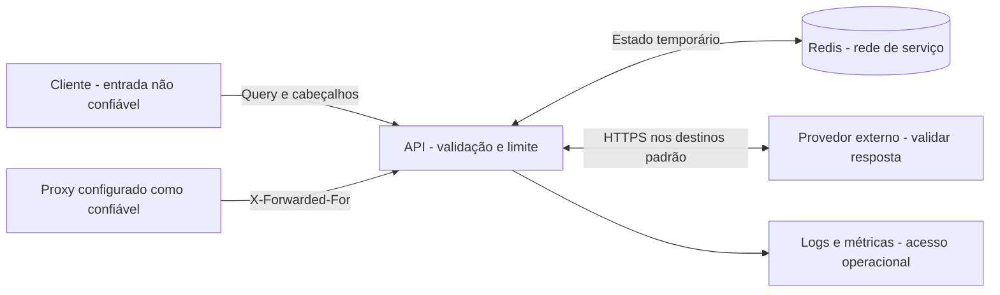

# Segurança e fronteiras de confiança

**Escopo:** análise estática do código e configuração locais em 2026-09-13.
Não representa teste de invasão ou certificação de um ambiente publicado.
[Índice](../PROJECT.md).

## Fronteiras

O acesso ao endpoint meteorológico é anônimo. Não há login, JWT, API key,
RBAC, tenant ou operações administrativas HTTP implementadas.

## Controles existentes e alcance

| ID     | Controle encontrado                                                                                                  | Limite da proteção                                                                                            | Evidência                                                                                                                 |
| ------ | -------------------------------------------------------------------------------------------------------------------- | ------------------------------------------------------------------------------------------------------------- | ------------------------------------------------------------------------------------------------------------------------- |
| SEG-01 | Schema de entrada, tamanho de texto, coordenadas, unidade e período.                                                 | Não valida horizonte temporal do provedor nem conteúdo pessoal no texto.                                      | [Schema](../src/climaprev/api/schemas/risk.py)                                                                            |
| SEG-02 | Token bucket Redis por identidade de rede, aplicado à rota de risco.                                                 | IP compartilhado divide cota; vários IPs multiplicam cota; não cobre health/docs.                             | [Dependências](../src/climaprev/api/deps.py), [limiter](../src/climaprev/infrastructure/rate_limit/redis_rate_limiter.py) |
| SEG-03 | `X-Forwarded-For` só aceito de peer explicitamente confiável. Cadeia de até 20 IPs, lida da direita para a esquerda. | Configuração incorreta pode concentrar ou permitir evasão de limites. Lista aceita IPs individuais, não CIDR. | [Identidade](../src/climaprev/api/deps.py)                                                                                |
| SEG-04 | CORS configurável, GET, cabeçalho `X-Request-ID`, sem credentials; wildcard rejeitado em ambiente `production`.      | CORS controla acesso pelo navegador, não autentica nem impede clientes HTTP diretos.                          | [Config](../src/climaprev/config.py), [app](../src/climaprev/main.py)                                                     |
| SEG-05 | ID de requisição com caracteres permitidos e até 64 caracteres; novo ID se inválido.                                 | O cliente pode reutilizar um ID válido; não é prova de autoria.                                               | [Observabilidade](../src/climaprev/api/observability.py)                                                                  |
| SEG-06 | Envelope de erro com mensagem genérica e código.                                                                     | Logs de outros componentes e servidores exigem configuração própria.                                          | [Handlers](../src/climaprev/main.py)                                                                                      |
| SEG-07 | Log estruturado do app omite query, IP e payload.                                                                    | Uvicorn/proxy/infraestrutura podem registrar URL com query; omissão no app não é garantia global.             | [Logger](../src/climaprev/api/observability.py)                                                                           |
| SEG-08 | Lock com token aleatório, aquisição NX e liberação/renovação condicionadas ao token em Lua.                          | Protege concorrência de atualização, não autentica usuários.                                                  | [Lock](../src/climaprev/infrastructure/cache/redis_lock.py)                                                               |
| SEG-09 | API vinculada ao loopback do host; Redis sem porta publicada.                                                        | Contêineres na rede ainda acessam Redis; não há ACL/TLS configurados no Compose.                              | [Compose](../docker-compose.yml)                                                                                          |
| SEG-10 | Clientes de provedor usam HTTPS por padrão, timeouts e retries limitados.                                            | URLs são strings configuráveis sem allowlist ou exigência de HTTPS na configuração.                           | [Config](../src/climaprev/config.py), [HTTP](../src/climaprev/infrastructure/http/client.py)                              |

## Permissões e informações expostas

| Ator                         | Acesso atual                                                   | Restrição proposta                                      |
| ---------------------------- | -------------------------------------------------------------- | ------------------------------------------------------- |
| Cliente HTTP                 | Consulta de risco e rotas acessíveis da aplicação.             | Não enviar informação privada no campo de local.        |
| Navegador externo            | Leitura cross-origin condicionada a CORS.                      | Configurar origens exatas do frontend.                  |
| Operador com acesso ao Redis | Pode ler chaves com texto, coordenadas e IP, e alterar estado. | Restringir acesso de rede e credenciais ao necessário.  |
| Operador de logs             | Depende da coleta implantada; não há perfis no app.            | Definir acesso e retenção fora do código.               |
| Provedor meteorológico       | Texto de local ou coordenadas/datas da consulta externa.       | Manter envio mínimo e revisar eventual nova integração. |

## Lacunas e medidas propostas

| ID     | Cenário observado / risco                                                                                   | Medida proposta                                                                                                     | Como comprovar                                                             |
| ------ | ----------------------------------------------------------------------------------------------------------- | ------------------------------------------------------------------------------------------------------------------- | -------------------------------------------------------------------------- |
| PEN-01 | Texto arbitrário e coordenadas podem revelar informação de localização. URLs podem chegar a logs de acesso. | Orientar entrada por cidade, reduzir registros de query e definir retenção/acesso dos logs.                         | Inspecionar saída do app, Uvicorn e proxy com consulta de teste.           |
| PEN-02 | Redis reúne cache, IPs e locks sem autenticação configurada neste Compose.                                  | Definir isolamento de produção, controle de acesso e proteção do transporte conforme topologia.                     | Testar conexões de origens permitidas e negadas.                           |
| PEN-03 | Rate limit só por IP não controla orçamento global de consultas; geocodificação não tem lock.               | Definir cotas globais, proteção de concorrência e limite de consumo externo.                                        | Carga com locais distintos e clientes distribuídos.                        |
| PEN-04 | Destinos HTTP configuráveis não têm validação de esquema/host.                                              | Validar destinos autorizados na implantação; separar exceção HTTP do mock local.                                    | Rejeitar configuração indevida sem afetar perfil de carga.                 |
| PEN-05 | Dockerfile não declara `USER`, inclui testes e dependências dev; dependências Python sem versões fixadas.   | Preparar imagem de produção com usuário sem privilégios, dependências reproduzíveis e somente arquivos necessários. | Inspecionar usuário, conteúdo e instalação reproduzível da imagem.         |
| PEN-06 | `/docs`, `/redoc`, `/openapi.json` usam defaults do FastAPI; health não exige autenticação.                 | Decidir exposição de documentação e saúde no proxy de produção.                                                     | Verificar rotas pela entrada pública e pela rede operacional.              |
| PEN-07 | Não há autenticação para recursos privados, contas ou histórico.                                            | Definir modelo de acesso antes de adicionar dados por usuário/organização.                                          | Testes de autorização entre identidades para cada recurso novo.            |
| PEN-08 | Cache JSON inválido pode causar erro genérico; normalização não valida todas as faixas físicas/finitude.    | Tratar cache corrompido e validar dados externos conforme contrato.                                                 | Testes com envelope inválido, valores não finitos e séries inconsistentes. |
| PEN-09 | Métricas guardam `request.url.path` como dimensão, inclusive caminhos arbitrários.                          | Normalizar rótulos de rota e limitar cardinalidade antes de exposição pública.                                      | Requisições a muitos caminhos inexistentes sem crescimento ilimitado.      |

Essas medidas são propostas derivadas do código local, não declarações de
controles já instalados. Não foi encontrada integração com infraestrutura de
produção suficiente para confirmar TLS de entrada, política de logs ou ACLs.

## Restrições para uma próxima implantação

Separar o perfil de carga da entrada pública; não usar seus limites elevados
como configuração padrão. Preservar validação no backend e não usar menu ou
CORS como autorização. Não colocar segredos no frontend, em documentos ou
em exemplos. Definir o destino e a retenção dos dados operacionais antes de
introduzir histórico de usuários, notificações ou novos fornecedores.
