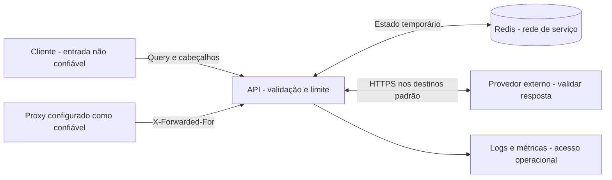

# Segurança e fronteiras de confiança

> **Revisão contextual — 30/10/2026.** [Estado vigente](../projeto/STATE.md) · [RDP](../contexto/RELATORIO-PENDENCIAS-2026-10-20.md) · [Refatoração e D+7](../operacoes/refatoracao-controle-d7-2026-10-30.md). Versão 0.1.0, janela 14/7, reference-v1 ativa; infraestrutura D+7 separada implementada e desativada. Piloto v5 preservado. Resultados e decisões anteriores neste documento são registros históricos e não qualificam automaticamente novos commits.

<!-- estado-vigente-2026-10-20 -->
> **Sincronização documental — 20/10/2026.** Documentação de referência: o [STATE vigente](../projeto/STATE.md) e o [RDP atualizado](../contexto/RELATORIO-PENDENCIAS-2026-10-20.md) definem versão, implementações, prioridades e pendências atuais. Contagens, prioridades e afirmações datadas anteriores permanecem históricas; não comprovam o estado atual nem autorização de ajuste/publicação.
>
> API e frontend possuem Composes/builds independentes, CSP de origem explícita, CORS e bloqueio público de /internal/. Exporter por worker é opt-in; templates de monitoramento não equivalem a serviços ativos. INMET ainda não confirmado ao vivo. develop está sem proteção/checks obrigatórios; o 403 administrativo não impediu verificar isso pela API de branch. Nenhuma regra remota foi alterada.

**Escopo:** controles do código e da execução local, revisão vigente em 20/10/2026;
progresso e testes em [tasks](../planejamento/evolucao-climaprev/tasks.md).
Não representa teste de invasão ou certificação de um ambiente publicado.
[Índice](../projeto/PROJECT.md).

## Fronteiras

O acesso ao endpoint meteorológico é anônimo. Não há login, JWT, API key,
RBAC, tenant ou operações administrativas HTTP implementadas.

## Controles existentes e alcance

| ID     | Controle encontrado                                                                                                  | Limite da proteção                                                                                                         | Evidência                                                                                                                 |
| ------ | -------------------------------------------------------------------------------------------------------------------- | -------------------------------------------------------------------------------------------------------------------------- | ------------------------------------------------------------------------------------------------------------------------- |
| SEG-01 | Schema de entrada, tamanho de texto, coordenadas, unidade e período.                                                 | Não valida horizonte temporal do provedor nem conteúdo pessoal no texto.                                                   | [Schema](../../src/climaprev/api/schemas/risk.py)                                                                            |
| SEG-02 | Token bucket Redis por identidade de rede, aplicado à rota de risco.                                                 | IP compartilhado divide cota; vários IPs multiplicam cota; não cobre health/docs.                                          | [Dependências](../../src/climaprev/api/deps.py), [limiter](../../src/climaprev/infrastructure/rate_limit/redis_rate_limiter.py) |
| SEG-03 | `X-Forwarded-For` só aceito de peer explicitamente confiável. Cadeia de até 20 IPs, lida da direita para a esquerda. | Configuração incorreta pode concentrar ou permitir evasão de limites. Lista aceita IPs individuais, não CIDR.              | [Identidade](../../src/climaprev/api/deps.py)                                                                                |
| SEG-04 | CORS configurável, GET/POST, cabeçalho `X-Request-ID`, sem credentials; wildcard rejeitado em ambiente `production`.      | CORS controla acesso pelo navegador, não autentica nem impede clientes HTTP diretos.                                       | [Config](../../src/climaprev/config.py), [app](../../src/climaprev/main.py)                                                     |
| SEG-05 | ID de requisição com caracteres permitidos e até 64 caracteres; novo ID se inválido.                                 | O cliente pode reutilizar um ID válido; não é prova de autoria.                                                            | [Observabilidade](../../src/climaprev/api/observability.py)                                                                  |
| SEG-06 | Envelope de erro com mensagem genérica e código.                                                                     | Logs de outros componentes e servidores exigem configuração própria.                                                       | [Handlers](../../src/climaprev/main.py)                                                                                      |
| SEG-07 | Runtime e entrada emitem metadados sanitizados; coletor retém até sete dias. | Coleta operacional, sujeita a perdas durante indisponibilidade/saturação; não é auditoria durável. | [Logger](../../src/climaprev/api/observability.py), [homologação](../operacoes/homologacao.md). |
| SEG-08 | Lock com token aleatório, aquisição NX e liberação/renovação condicionadas ao token em Lua.                          | Protege concorrência de atualização, não autentica usuários.                                                               | [Lock](../../src/climaprev/infrastructure/cache/redis_lock.py)                                                               |
| SEG-09 | Desenvolvimento usa loopback; homologação mantém API/Redis sem portas diretas e Redis autenticado em rede interna. | Namespace não substitui rede/credencial; acesso ao host/container é operacional. | [Desenvolvimento](../../docker-compose.yml), [homologação](../../docker-compose.homolog.yml). |
| SEG-10 | Clientes de provedor usam HTTPS por padrão, timeouts e retries limitados.                                            | Produção exige HTTPS, host autorizado e porta padrão/443, sem userinfo ou fragmento; load/test preservam mocks explícitos. | [Config](../../src/climaprev/config.py), [HTTP](../../src/climaprev/infrastructure/http/client.py)                              |

## Permissões e informações expostas

| Ator                         | Acesso atual                                                   | Restrição / alcance                                      |
| ---------------------------- | -------------------------------------------------------------- | ------------------------------------------------------- |
| Cliente HTTP                 | Consulta de risco e rotas acessíveis da aplicação.             | Não enviar informação privada no campo de local.        |
| Navegador externo            | Leitura cross-origin condicionada a CORS.                      | Interface deste ciclo usa a mesma origem; CORS externo exige configuração.                  |
| Operador com acesso ao Redis | Pode ler chaves com texto, coordenadas e IP, e alterar estado. | Restringir acesso de rede e credenciais ao necessário.  |
| Operador de logs             | Acesso operacional ao volume de logs sanitizados; sem perfis no app.            | Volume restrito à operação, retenção local de até sete dias.               |
| Provedor meteorológico       | Texto de local ou coordenadas/datas da consulta externa.       | Manter envio mínimo e revisar eventual nova integração. |

## Tratamento das lacunas identificadas

| ID     | Cenário observado / risco                                                                                   | Medida proposta                                                                                                     | Como comprovar                                                                                                  |
| ------ | ----------------------------------------------------------------------------------------------------------- | ------------------------------------------------------------------------------------------------------------------- | --------------------------------------------------------------------------------------------------------------- |
| PEN-01 | Tratado em T13/T20: query/IP/payload fora dos logs, sem access log bruto no runtime e entrada. | Campo de local continua livre; orientação por cidade não é filtro de dados pessoais. | [T13](../planejamento/evolucao-climaprev/evidence/t13.md), [T20](../planejamento/evolucao-climaprev/evidence/t20.md). |
| PEN-02 | Resolvido na homologação em T19: Redis autenticado, ACL de comandos/chaves e rede interna. | Configuração de desenvolvimento continua separada; segredos são provisionados fora do Git. | [Evidência T19](../planejamento/evolucao-climaprev/evidence/t19.md). |
| PEN-03 | Resolvido em T14: cota global por ambiente/destino antes de cada tentativa externa.                         | Cache hit não consome orçamento; indisponibilidade do Redis bloqueia chamadas.                                      | [Evidência T14](../planejamento/evolucao-climaprev/evidence/t14.md).                                               |
| PEN-04 | Resolvido em T11: destinos de produção validados.                                                           | Allowlist explícita e erros sem URL/credenciais; exceção local mantida.                                             | [Evidência T11](../planejamento/evolucao-climaprev/evidence/t11.md).                                               |
| PEN-05 | Resolvido em T17/T18: dependências com hashes e runtime UID 10001. | Imagem final sem testes/dev/.env; contexto de build por lista explícita. | [T17](../planejamento/evolucao-climaprev/evidence/t17.md), [T18](../planejamento/evolucao-climaprev/evidence/t18.md). |
| PEN-06 | `/docs`, `/redoc`, `/openapi.json` usam defaults do FastAPI; health não exige autenticação.                 | Decidir exposição de documentação e saúde no proxy de produção.                                                     | Verificar rotas pela entrada pública e pela rede operacional.                                                   |
| PEN-07 | Não há autenticação para recursos privados, contas ou histórico.                                            | Definir modelo de acesso antes de adicionar dados por usuário/organização.                                          | Testes de autorização entre identidades para cada recurso novo.                                                 |
| PEN-08 | Resolvido em T2/T7: envelope corrompido vira miss; dados inválidos viram 502.                               | Validação antes da avaliação/cache e contador de corrupção sem chave.                                               | [T2](../planejamento/evolucao-climaprev/evidence/t2.md), [T7](../planejamento/evolucao-climaprev/evidence/t7.md).     |
| PEN-09 | Resolvido em T15: template da rota e `unmatched` para desconhecidas.                                        | Snapshot por processo, sem agregação global automática.                                                             | [T15](../planejamento/evolucao-climaprev/evidence/t15.md), [T16](../planejamento/evolucao-climaprev/evidence/t16.md). |

Os estados resolvidos indicam controles locais com as evidências citadas.
Itens de implantação pública e identidade permanecem fora deste ciclo;
essas evidências não representam certificação ou inspeção de produção.

## Restrições para uma próxima implantação

Separar o perfil de carga da entrada pública; não usar seus limites elevados
como configuração padrão. Preservar validação no backend e não usar menu ou
CORS como autorização. Não colocar segredos no frontend, em documentos ou
em exemplos. Definir o destino e a retenção dos dados operacionais antes de
introduzir histórico de usuários, notificações ou novos fornecedores.
